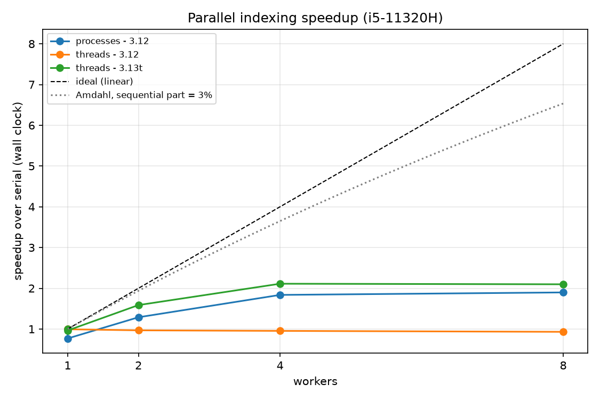

# Lab 05 — Concurrency and the GIL

`findex index` can now use every core: the build is split into `build_partial` (map, runs in
workers) and `merge` (reduce, runs in the parent), and the *same two functions* run under a plain loop,
a thread pool or a process pool. Version 0.5.0.

## Quick start

```bash
findex index data/gutenberg --out index.bin                     # auto: processes for corpora >= 2 MB
findex index data/gutenberg --out index.bin --executor serial
findex index data/gutenberg --out index.bin --executor threads   --workers 8
findex index data/gutenberg --out index.bin --executor processes --workers 8
findex -v index data/gutenberg --out index.bin                   # logs the plan / map / merge split
```

| Flag | Meaning |
| --- | --- |
| `--executor {serial,threads,processes}` | how `build_partial` is run. Default: processes for corpora of at least 2 MB (`MIN_PARALLEL_BYTES`), serial below |
| `--workers N`, `-j N` | pool size (default: usable CPUs). Ignored by `serial` |

The summary table shows the executor, the number of chunks, and the map / merge times. Phrase queries
still need `--positions`. `--workers/--executor` apply to a directory of `.txt` files with the default
`--storage array`; a `.jsonl` corpus or another storage falls back to the serial Lab 04 builder (with a warning).

## Design

| Piece | Where | What it does |
| --- | --- | --- |
| `build_partial(paths, first_doc_id, positions=)` | `parallel.py` | module-level function (so a process can import it by name); reads **its own files** and returns a compact `PartialIndex` of `array('I')` buffers |
| `merge(partials)` | `parallel.py` | orders partials by doc-id range and **concatenates** each term's arrays; the first partial that mentions a term donates its arrays (no copy) |
| `plan_chunks(paths, n, sizes)` | `parallel.py` | cuts the sorted file list into contiguous chunks of about equal **bytes**, and reserves each chunk's doc-id range up front |
| `run_chunks(...)` | `parallel.py` | `serial` loop, `ThreadPoolExecutor` or `ProcessPoolExecutor(mp_context=spawn)` |
| `build_parallel(...)` | `parallel.py` | plan → map → merge, returns the index and a `BuildTimings` (plan / map / merge / wall / CPU) |
| `findex.parbench` | `parbench.py` | benchmark runner and report/plot generator |

Decisions worth knowing:

* **Paths go in, compact results come out.** Workers read their own files; nothing large crosses a pipe on the way in.
* **Unique doc ids by construction.** `list_documents` sorts the files, so doc ids are stable across runs; chunk *k* owns
  `first_doc_id … first_doc_id + len - 1`. Partial postings never collide, so the merge needs no sort.
* **Identical output.** Terms enter the merged index in global first-appearance order, so the saved file is
  **byte-identical** to the Lab 04 builder's, whatever the executor, worker count or chunking
  (`tests/test_parallel.py` compares the saved files byte for byte, with and without positions, including a real process pool).
* **`spawn` everywhere.** A worker is a fresh interpreter that re-imports the main module. `findex/__main__.py` and the
  console script are guarded by `if __name__ == "__main__"`; `test_python_dash_m_findex_index_with_processes_does_not_recurse`
  proves a `python -m findex index --executor processes` run terminates. (Running a pool at the top level of your own script
  without the guard fails at once with `RuntimeError` / `BrokenProcessPool`, it does not hang.)
* **Failures are loud.** A worker exception is re-raised in the parent (for processes with the worker's traceback as
  `__cause__`) and queued chunks are cancelled; a worker that dies surfaces as `BrokenProcessPool`.
* **More chunks than workers** (`chunks_per_worker=2`) lets a fast worker take an extra chunk, which evens out the very
  different sizes of books, at the price of a slightly larger merge.

## Benchmark

Every measurement is a **fresh child process** (peak memory is that run's own), preceded by one unmeasured warm-up build;
each configuration is measured `--runs` times (default 3), round-robin so slow drift is spread evenly; the table reports
the **median** and the min–max spread. CPU time = parent CPU + the CPU of the worker processes.

```powershell
# 1. normal build: serial, threads and processes for 1, 2, 4, 8 workers (+ CPU count)
uv run python -m findex.parbench run data\gutenberg --out bench\gil.json --label "3.12" --runs 3

# 2. free-threaded build (see "Free-threaded Python" below)
uv python install 3.13t
uv run python -m findex.parbench run data\gutenberg --out bench\nogil.json --label "3.13t" `
    --python (uv python find 3.13t) --gil 0 --executors serial threads --runs 3

# 3. table + speedup plot (PNG) from the saved measurements
uv run python -m findex.parbench report bench\gil.json bench\nogil.json `
    --plot docs\speedup.png --title "Parallel indexing speedup (<your CPU>)"
```

(Close the browser and plug the laptop in first. A full grid on ~100 MB takes several minutes.)

Machine: <!-- TODO: CPU model, physical cores / logical CPUs, RAM, OS, Python versions. From Lab 01: Intel Core i5-11320H (4 cores / 8 threads), 16 GB, Windows 11 -->

<!-- TODO: paste the table printed by `report` -->

| Interpreter | Executor | Workers | Wall, s (median) | min-max | CPU, s | Peak RSS (parent) | Merge, s | Speedup |
| --- | --- | ---: | ---: | ---: | ---: | ---: | ---: | ---: |
| 3.12 [GIL on] | serial | 1 | … | … | … | … | … | 1.00x |
| 3.12 [GIL on] | threads | 2 / 4 / 8 | … | … | … | … | … | … |
| 3.12 [GIL on] | processes | 2 / 4 / 8 | … | … | … | … | … | … |
| 3.13t [GIL OFF] | threads | 2 / 4 / 8 | … | … | … | … | … | … |



<!-- TODO: after committing docs/speedup.png, check that the image renders on GitHub -->

## Free-threaded Python

```powershell
uv python install 3.13t
uv run --python 3.13t python -c "import sys; print(sys.version, sys._is_gil_enabled())"   # ... False
uv run --python 3.13t python experiments\race_demo.py data\gutenberg --docs 40 --threads 8
```

<!-- TODO: paste the first line (it must show `sys._is_gil_enabled()` → False) and the output of race_demo on both builds -->

`PYTHON_GIL=0` forces the GIL off even if a C extension has not declared support (the benchmark's `--gil 0`). The
production code is correct on both builds because workers share no mutable state; `experiments/race_demo.py` shows the shared
`Counter` / `dict` designs that are *not*, and what the GIL was hiding.

## Experiments

```powershell
uv run python experiments\gil_demos.py                      # CPU-bound timings, lost updates, switch interval, lambda error, bytecode
uv run python experiments\race_demo.py data\gutenberg       # the shared-Counter race on the real workload
uv run python experiments\pickle_tax.py data\gutenberg      # what crossing a process boundary costs
uv run python experiments\io_bound_demo.py --mode sleep     # I/O-bound: threads DO scale (or --mode urls --tasks 30)
```

Observed while developing (a 1-core sandbox, **re-run on your machine**): on CPython 3.12 a plain `x += 1` loses nothing in
a thread test, while *read; function call; write* loses up to ~40 % of the updates and a `Lock` fixes it. On the
free-threaded build the shared `Counter.update` also loses updates, which it does not on the GIL build.

## The one-page explanation

**[docs/lab05-gil.md](docs/lab05-gil.md)** — why threads did not scale under the GIL, why processes did and what they cost
(CPU vs wall, RSS, pickling), where Amdahl's law shows up in the merge time, what changed on 3.13t, the race and its fix.
<!-- TODO: fill the numbers and rewrite it in your own words -->

## Default executor

`--executor` defaults to *auto*: **processes** for a corpus of at least 2 MB, serial below that. <!-- TODO: confirm with YOUR table that processes win; if not, edit DEFAULT_PARALLEL_EXECUTOR in src/findex/parallel.py and say so here -->

## Tests

`uv run pytest` — 243 tests, 94.8 % branch coverage (CI threshold 90 %). New in this lab: chunk planning (including a Hypothesis
property that chunks tile the corpus exactly), `build_partial`/`merge` (pickle round trip, overlap and mixed-positions errors,
arrival-order independence), **byte-identical files** for serial / threads / processes with and without positions, worker failures
(thread and process), spawn safety of `python -m findex`, the benchmark's statistics/table/plot, and the CLI flags.
Process-pool tests are marked `slow` (spawn costs ~1 s each on Windows). The Windows-only branch of `peak_rss_bytes` is excluded
from coverage (it runs only on Windows).
