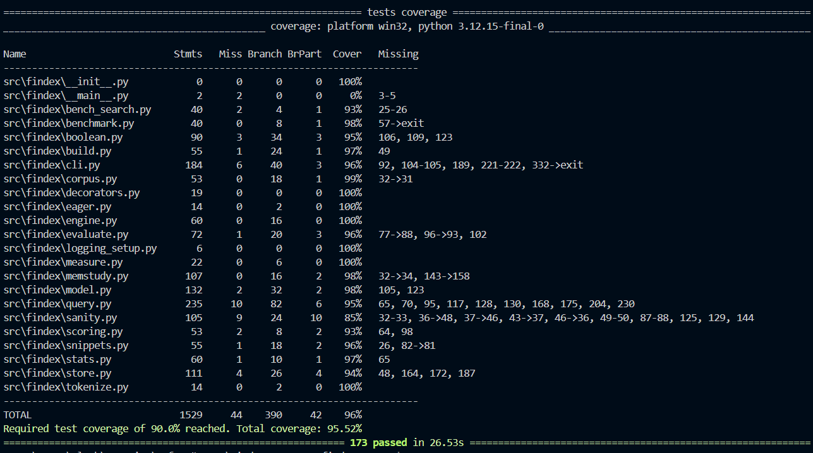
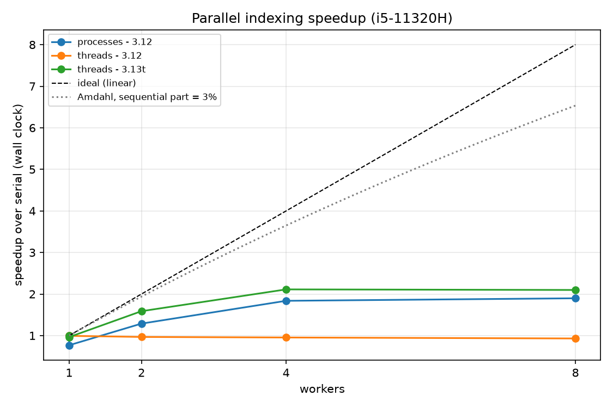

# findex

A small search engine built step by step (course: *Python — Build a Search Engine*).

- **Lab 01** — streaming corpus intake, tokenizer, corpus statistics in constant memory (tag `lab-01`)
- **Lab 02** — inverted index, Boolean search, persistence, memory study (tag `lab-02`) → see [Lab 02](#lab-02--the-inverted-index)
- **Lab 03** — `Index` as a Python object, TF-IDF / BM25 ranking, query language, snippets (tag `lab-03`) → see [Lab 03](#lab-03--ranking-and-the-object-model)

## Corpus


Project Gutenberg plain-text books, 150 books ≈ 90 MB, stored in `data/gutenberg/` (not committed).

```bash
uv sync
uv run python scripts/fetch_gutenberg.py --count 150   # ~50 MB; use 1000 for the full corpus
```

Any directory of `*.txt` files or a `*.jsonl` / `*.jsonl.gz` file (one object per line with a `"text"` field) works.

## Usage

```bash
uv run python -m findex.stats data/gutenberg                # full corpus
uv run python -m findex.stats data/gutenberg --limit 100    # first 100 documents
uv run python -m findex.benchmark data/gutenberg --limit 500  # eager vs lazy table
uv run pytest && uv run ruff check .
```

## Layout

| File | Role |
| --- | --- |
| `src/findex/corpus.py` | `iter_documents(root)` — generator yielding `Document(doc_id, path, text)` one at a time; bad UTF-8 is logged and replaced, not fatal |
| `src/findex/tokenize.py` | `tokenize(text)` — generator; NFC → casefold → `re.finditer` |
| `src/findex/stats.py` | single-pass pipeline `iter_documents → tokenize → Counter`, with time and peak memory (`tracemalloc`) |
| `src/findex/eager.py` | deliberately greedy list-based version (for the comparison only) |
| `src/findex/benchmark.py` | runs both versions and prints the Markdown table |

## Tokenizer rules

1. Normalize: NFC → `casefold()` → NFC (`Straße` ≡ `STRASSE`; `café` composed ≡ decomposed).
2. Token = run of Unicode letters/digits (`_` excluded), so Cyrillic etc. just work.
3. Apostrophe **between** word characters stays in the token (`don't`, `п'ять`); `’` and `ʼ` are mapped to `'`. Edge quotes are dropped.
4. Hyphen **between** word characters stays (`well-known`). Spaced dashes (` - `, `—`) split.
5. Digits are ordinary token characters (`mp3`, `2026`). `3.14` → `3`, `14` (no number-aware rules).
6. Everything else separates tokens.

## Eager vs lazy

Same corpus slice, same results (the benchmark asserts they agree).
Elapsed is measured in a run **without** `tracemalloc`; peak memory in a separate run **with** it.


| Version | Documents | Tokens | Peak memory | Elapsed |
| --- | ---: | ---: | ---: | ---: |
| eager (lists) | 150 | 15,094,967 | 1.0 GiB | 17.68 s |
| lazy (generators) | 150 | 15,094,967 | 95.8 MiB | 14.79 s |

Machine: Intel Core i5-11320H, 16 GB RAM, Windows 11, Python 3.12.3

### Where did the memory go?


The eager version keeps three things alive at once: the full text of every document (`list(iter_documents)`),
a list of lists holding every token as a separate `str` object (~50+ bytes each, plus 8 bytes per list slot),
and a flat copy of all token references. Memory therefore grows with corpus size (O(total tokens)).
The lazy version keeps only the current document, the regex match in flight, and the `Counter`,
which grows with the *vocabulary* (distinct terms), not with the number of tokens (O(vocabulary)).
It is not zero because the document text, the Counter and interned token strings still have to live somewhere.


---

# Lab 02 — The inverted index

## Quick start

```bash
uv run findex index data/gutenberg --out index.bin          # build + save (binary format)
uv run findex search index.bin "whale NOT ahab"             # load + search
uv run findex search index.bin "sea OR ocean" --engine set  # set-based engine
uv run python -m findex.bench_search index.bin                        # merge vs set table
uv run python -m findex.memstudy data/gutenberg                       # memory / file tables
```

Useful flags: `--limit N` (first N docs), `--positions` (store token offsets),
`--storage {dataclass,slots,array}`, `--format {binary,pickle}`, `--no-tracemalloc` (clean timings).
Both CLIs print elapsed time and peak memory. Note: `tracemalloc` slows code 3–5×, so timings printed
next to a peak are inflated; the tables below take times from separate runs without it.

## Design

| Module | Role |
| --- | --- |
| `model.py` | `Posting`, `DocMeta` (`@dataclass(frozen=True, slots=True)`, hashable), `PlainPosting` (baseline), `PostingList` (array storage), `Index` |
| `build.py` | `build_index(docs, storage=, positions=)` — one pass over the lazy stream; per-document `Counter`, flushed at the end of each document into a `defaultdict`. Doc ids arrive ascending, so every postings list is sorted for free |
| `boolean.py` | two-pointer merge (AND / OR / AND-NOT) and the set-based twin; `evaluate(query, index, engine)` |
| `store.py` | `save` / `load` in two formats: `pickle` and a custom `binary` one |
| `index.py`, `search.py` | the CLIs; `bench_search.py`, `memstudy.py` produce the tables below |

`model.py` is separate from the CLI on purpose: classes defined in a module run with `python -m` live in
`__main__`, and pickle would record them as `__main__.Posting`, which cannot be loaded by any other program.

`Index` holds `postings: dict[str, ...]`, `doc_lengths: dict[int, int]` (for BM25 in Lab 3) and
`doc_meta: dict[int, DocMeta]` (path + title; the title is the `Title:` header if present, else the first line).
The builder returns a plain `dict` (not the `defaultdict`): a lookup of an unknown term must not create entries,
and a `defaultdict` with a lambda factory cannot be pickled.

### Query language

Evaluated left to right, **no precedence** (a real parser arrives in Lab 3):
`a b` and `a AND b` = intersection, `a OR b` = union, `a NOT b` = `a` without `b`, `NOT b` = all documents without `b`.
`a OR b c` therefore means `(a OR b) AND c`. Keywords are upper-case. Terms go through the same normalization as indexing.

### Storage formats

* **pickle** — one call, any storage. **Security:** `pickle.load` can run arbitrary code stored in the file,
  so a pickle from someone else is a program, not data. `findex.search` prints a warning when it opens one.
* **binary** — `FINDEXBN` magic, a JSON header (terms, counts, doc metadata, doc lengths), then raw `array('I')`
  buffers per term (`doc_ids`, `tfs`, and optionally `positions`: the positions of posting *i* are the next `tf[i]` values).
  Loading only parses JSON and copies bytes, so it is safe, and always yields `array` storage.

## Results

Corpus: 150 documents, 585,554 terms, 1,494,103 postings. 
Machine: Intel Core i5-11320H, 16 GB RAM, Windows 11, Python 3.12.3

### Memory: three ways to store postings


| Postings representation | Peak (build) | Resident index | B/posting | Build | File (pickle) | Save | Load |
| --- | ---: | ---: | ---: | ---: | ---: | ---: | ---: |
| `list[Posting]`, plain `@dataclass` | 257.1 MiB | 228.3 MiB	 | 160.2 | 16.69 s | 42.8 MiB | 1.86 s | 1.11 s |
| `list[Posting]`, `slots=True` | 214.5 MiB | 182.7 MiB | 128.2 | 18.16 s | 34.2 MiB | 4.84 s | 6.02 s |
| `array('I')` pairs (no objects) | 226.8 MiB | 192.1 MiB | 134.8 | 16.70 s | 51.6 MiB | 5.15 s | 1.19 s |

**Where the bytes went.** 
A posting is two small integers, yet the list representations pay for an *object* around them.
Per posting, `list[Posting]` stores an 8-byte pointer in the list, the posting object itself
(56 B with `slots=True`; 48 B plus a separate instance `__dict__` for the plain class, although CPython 3.12
often keeps those attributes inline, so the gap to `slots` is smaller than older Python versions show),
and two `int` objects of 28 B each. (CPython caches ints in -5..256, so a tiny test corpus hides this cost: only
doc ids above 256 are separate objects.) The empty `positions` tuple is a shared singleton, so it costs nothing per posting.
`array('I')` removes all of that: 4 B for the doc id plus 4 B for the tf, with no per-element object and no
pointer, i.e. ~8 B/posting plus small per-term overhead (two arrays and a `PostingList` per term) and growth slack.
The "peak" is a little above "resident" because the per-document `Counter` and the `defaultdict` growth are live during the build.

### File formats


| Format | In-memory storage | File size | Save | Load |
| --- | --- | ---: | ---: | ---: |
| pickle | slots | 34.2 MiB | 3.45 s | 6.42 s |
| pickle | array | 51.6 MiB | 4.98 s | 1.14 s |
| binary | array | 24.8 MiB | 0.60 s | 2.79 s |

Why `pickle` of `slots` objects loads slowly: a frozen, slotted dataclass is rebuilt by a generated
`__setstate__` that sets every field through `object.__setattr__` — a Python-level call per field per posting —
while `array` buffers are restored with a single `memcpy`-like operation.

### Cost of token positions


| Storage | Positions | Resident index | Pickle file | vs. no positions (file) |
| --- | --- | ---: | ---: | ---: |
| slots | off | 182.7 MiB | 34.2 MiB | 1.0x |
| slots | on | 756.9 MiB | 94.4 MiB | 2.8x |
| array | off | 192.1 MiB | 51.6 MiB | 1.0x |
| array | on | 302.1 MiB | 117.6 MiB | 2.3x |

### Boolean search: merge vs set


| Op | Case | len(a) | len(b) | merge | set | winner |
| --- | --- | ---: | ---: | ---: | ---: | --- |
|AND |	common & common |	150 |	150 |	12.5 µs |	6.1 µs | set | x2.1 |
|AND |	common & rare |	150 |	1 |	5.8 µs |	1.7 µs | set | x3.4 |
|AND |	rare & rare |	1 |	1 |	0.2 µs |	0.4 µs |	merge | x2.2 |
|OR |	common and common |	150 |	150 |	12.7 µs |	5.3 µs |	set | x2.4 |
|OR |	common and rare |	150 |	1 |	7.7 µs |	3.3 µs |	set | x2.3 |
|NOT |	common - common |	150 |	150 |	14.1 µs |	3.6 µs |	set | x3.9 |
|NOT |	common - rare |	150 |	1 |	12.8 µs |	3.3 µs |	set | x3.9 |

Both engines receive identical pre-extracted id lists and return sorted lists (the benchmark asserts they agree).
Merge is O(|a|+|b|) with no extra memory but runs as a bytecode loop; `set` also costs O(|a|+|b|)
(it hashes every element) but the work happens in C. 
`set` almost always outperforms `merge`,except for short lists, because `set` uses C (which is runs very fast), whereas `merge` uses a loop that iterates through bytes; therefore, `set` wins with long lists. In the case of very short lists, `merge` may turn out to be faster, since `set` spends time creating collections, whereas `merge` does practically nothing.
Merge remains the design to keep: it streams, needs no hashing, works on compressed postings and
extends to phrase queries (Lab 3).


---

# Lab 03 — Ranking and the object model

## Quick start

Phrase queries need token positions, so build the index with `--positions`
(`--storage array` keeps it compact). Indexes from Lab 02 are not compatible: rebuild.

```bash
uv run findex index data/gutenberg --out index.bin --storage array --positions
uv run findex search index.bin 'whale AND (sea OR ocean) NOT ahab "white whale"' -v --repeat 2
uv run findex search index.bin "whale" --scorer tfidf --top 5
uv run python -m findex.sanity index.bin                          # the three ranking checks
uv run python -m findex.evaluate index.bin eval/queries.json --show   # precision@5
```

`-v` prints the `@timed` lines and `cache miss` / `cache HIT`. In Python:

```python
from findex.store import open_index
from findex.engine import SearchEngine
from findex.scoring import BM25

with open_index("index.bin") as ix:  # closed again on exit, even after an exception
    print(len(ix), "whale" in ix, ix["whale"][0], ix)  # Index(terms=..., docs=...)
    for hit in SearchEngine(ix, BM25(k1=1.2)).search('"white whale" NOT ahab', k=5):
        print(hit, hit.snippet)
```

## What changed

| Module | Role |
| --- | --- |
| `model.py` | `Index(Mapping)`: `len`, `in`, `ix[term]` (`KeyError`), iteration, `repr`; `num_docs`, `avg_doc_length` (`cached_property`), `doc_length`, `df`, `close()`. `PostingList` is now a `Sequence[Posting]` view over the arrays |
| `store.py` | `open_index(path)` — generator-style context manager; `load` is `@timed` |
| `scoring.py` | `Scorer` protocol, `TfIdf`, `BM25(k1=1.5, b=0.75)` (frozen dataclasses with `__call__`), `SearchResult` (`order=True`) |
| `query.py` | recursive-descent parser → `Term` / `Phrase` / `And` / `Or` / `Not` with `&`, `\|`, `~` and `evaluate(index)` |
| `engine.py` | `search()` (`@timed`, `heapq.nlargest`) and `SearchEngine` with an `lru_cache`d `query → doc ids` |
| `snippets.py` | ±80-character window around the densest cluster of query terms, matches highlighted |
| `decorators.py` | `timed` (`functools.wraps`; works bare and with arguments) |
| `sanity.py`, `evaluate.py` | produce the evidence tables below |

Design notes:

* **Scorer = protocol, not base class.** Anything with `score(term, posting, index) -> float` works
  (`isinstance(x, Scorer)` is a structural check); the tests plug in a scorer that inherits from nothing.
* **TF-IDF** = `(1 + ln tf) · ln(N / df)`. **BM25** = `idf · tf(k1+1) / (tf + k1(1 − b + b·dl/avgdl))`, with Lucene's
  `idf = ln(1 + (N − df + 0.5)/(df + 0.5))`, which never goes negative.
* **`SearchResult` fields start with `score`** because `order=True` compares fields in definition order;
  `title` and `snippet` are `compare=False`. Keyword construction: `SearchResult(score=…, doc_id=…, title=…)`.
* **Grammar:** NOT binds tighter than AND, AND tighter than OR; juxtaposition is an implicit AND, so
  `a OR b c` parses to `Or(a, And(b, c))`. Keywords are UPPER-case (`and` is an ordinary word). This replaces Lab 02's
  left-to-right evaluation (`boolean.evaluate` is kept only for the Lab 02 tests).
* **Phrase** = intersect the doc lists, then for word *i* shift its positions by −*i* and merge-intersect with word 0's.
* **Cache:** `lru_cache` wraps a bound method *per engine instance*, so the cache does not pin every engine alive
  through `self`; it stores tuples, which are hashable and cannot be mutated by callers.
* **Snippets** need the original text, so they work for `.txt` corpora (path stored in `DocMeta`); documents that live
  inside a `.jsonl` get no snippet.

## Evidence

Corpus: Index(terms=585_554, docs=150, storage='array', positions=True); document length median 66,752, avg 100,633
Machine: Intel Core i5-11320H, 16 GB RAM, Windows 11, Python 3.12.3

### Ranking sanity checks

### Check 1 -- a rare term outranks a common one

Query `aage OR whole`. `aage` occurs in 1 docs, `whole` in 130.

| Document | Contains | tf | length | BM25 score | Rank |
| --- | --- | ---: | ---: | ---: | ---: |
| 14.txt | only `aage` (rare) | 1 | 282,878 | 2.541 | 1 |
| 17.txt | only `whole` (common) | 72 | 285,849 | 0.348 | 53 |

PASS: the rare-term document ranks higher.

### Check 2 -- the 20th repetition adds (almost) nothing under BM25

Term `own`, document 146.txt (length 70,092); the tf values are hypothetical, idf and length are real.

| tf | BM25 | TF-IDF (1+ln tf) | TF-IDF (raw tf) |
| ---: | ---: | ---: | ---: |
| 1 | 0.1340 | 0.1128 | 0.1128 |
| 2 | 0.1832 | 0.1910 | 0.2256 |
| 5 | 0.2349 | 0.2943 | 0.5640 |
| 10 | 0.2593 | 0.3725 | 1.1280 |
| 19 | 0.2727 | 0.4449 | 2.1431 |
| 20 | 0.2734 | 0.4507 | 2.2559 |

BM25: going 1->2 adds 0.0492, going 19->20 adds 0.0008 (1.6% of the first gain).
PASS: saturation (limit for tf->inf is 0.289).

### Check 3 -- a short document with one match beats a very long one

Query `own`: both documents contain it exactly once (tf = 1).

| Document | length | BM25 | Rank (BM25) | TF-IDF |
| --- | ---: | ---: | ---: | ---: |
| 8.txt (short) | 3,875 | 0.2040 | 130 | 0.1128 |
| 136.txt (long) | 11,304 | 0.1927 | 133 | 0.1128 |

PASS: BM25 prefers the short document; TF-IDF (no length normalization) ties them.

1. **Rare term above common term** — a document with a single `rare` outranks one with 24 `common`, same length, because idf(rare) ≫ idf(common)" -->
2. **20th repetition adds almost nothing** — BM25: going 1->2 adds 0.0492, going 19->20 adds 0.0008 (1.6% of the first gain) why: contribution tends to idf·(k1+1)
3. **Short document above very long one** — BM25 prefers the short document; TF-IDF ties them because it has no length normalization (b = 0 behaves the same)

### precision@5, TF-IDF vs BM25

10 queries, labeled by hand **before** looking at any ranking (`eval/queries.json`; format in `eval/queries.example.json`).


| # | Query | Relevant | P@5 TF-IDF | P@5 BM25 |
| ---: | --- | ---: | ---: | ---: |
| 1 | `another class of servants` | 1 | 0.20 | 0.20 |
| 2 | `devising of idols` | 1 | 0.20 | 0.20 |
| 3 | `To think he may be lying dead there` | 1 | 0.00 | 0.00 |
| | **mean** | | **0.13** | **0.13** |

In this "match" we have a tie

### `@timed` and cache traces


```text
findex.timing: load took 2642.82 ms
findex.engine: match 'whale sea' -> 19 docs [cache miss]
findex.timing: search took 0.76 ms
findex.engine: match 'whale sea' -> 19 docs [cache HIT]
findex.timing: search took 0.65 ms
findex.timing: search took 276.09 ms
Index(terms=585_554, docs=150, storage='array', positions=True)
query: 'whale sea'  scorer=bm25  ->  19 matching documents
```

### Query with brackets and a phrase (demo)


Index(terms=585_554, docs=150, storage='array', positions=True)
query: 'whale AND ocean NOT ahab "white whale"'  scorer=bm25  ->  0 matching documents


load + search: 9.034 s (inflated by tracemalloc), peak memory 383.0 MiB; query part 3.50 ms


# Lab 04 — A real tool

findex is now an installable, typed, tested command-line program with CI and a tagged release.

## Install and use

```bash
# from the GitHub Release (wheel attached to v0.4.0) -- no clone needed:
uv tool install https://github.com/YOUR_GITHUB_USER/findex/releases/download/v0.4.0/findex-0.4.0-py3-none-any.whl
# or from a clone / a local wheel:
uv tool install .                      # puts `findex` on your PATH
uv build && uv tool install dist/findex-0.4.0-py3-none-any.whl

findex --help
findex index data/gutenberg --out index.bin --positions          # rich progress bar (stderr)
findex search index.bin 'python AND (async OR await) NOT java "event loop"'   # rich table
findex search index.bin "whale" --json | jq .title               # JSON lines on stdout
findex stats index.bin --top 10
findex -vv search index.bin "whale" --repeat 2                   # timings + cache hit on stderr
```

(On Windows PowerShell write a phrase as `'... \"white whale\"'`.)

| Command | What it does |
| --- | --- |
| `findex index CORPUS --out FILE [--positions] [--limit N] [--storage …] [--format …]` | build and save an index; progress bar and summary |
| `findex search INDEX "QUERY" [-k 10] [--scorer bm25\|tfidf] [--engine merge\|set] [--json] [--no-snippets] [--repeat N]` | ranked results as a table with highlighted snippets, or JSON lines |
| `findex stats INDEX [--top N] [--json]` | documents, tokens, vocabulary, postings, document lengths, most frequent terms |
| `findex -v / -vv …` | INFO / DEBUG logs on **stderr** (`-v` is also accepted after the subcommand) |

Contract: **stdout carries data, stderr carries diagnostics** (progress bar, logs, errors), so
`findex search … --json | jq` is never polluted. Expected failures — missing index or corpus, malformed or
damaged index file, bad query, phrase on an index built without `--positions` — print **one line**
`error: …` and exit with status 1, never a traceback. Usage errors (unknown option, invalid `--scorer`) use
status 2. Logging is configured in one place (`logging_setup.configure_logging`, called by the CLI entry point);
library modules only call `logging.getLogger(__name__)`; `@timed` logs at DEBUG.

## Typing

`pyright` in **strict** mode with **0 errors** (`[tool.pyright] typeCheckingMode = "strict"`,
`reportUnnecessaryTypeIgnoreComment = true`, so stale ignores fail the build).

* `Scorer` is a `typing.Protocol`; `TfIdf` and `BM25` satisfy it without inheriting from it
  (pyright checks the call sites; the test suite also plugs in a third scorer that inherits from nothing).
  `PostingView` is a second Protocol, so `Posting` (frozen, slots) and `PlainPosting` (plain dataclass) are
  interchangeable wherever a posting is read.
* Generators and pipelines: `Iterator[...]` as the return type of generator functions, `Iterable[...]` for what
  functions accept (`build_index(docs: Iterable[Document])`).
* `Literal` for closed string sets: `EngineName = Literal["merge", "set"]`, `ScorerName`, `StorageName`,
  `FormatName` — typer turns them into validated choices in `--help`.
* `@timed` is typed with PEP 695 / `ParamSpec` (`def timed[**P, R]`), so a decorated function keeps its exact
  signature for the type checker.
* `TypedDict` for JSON-shaped data (`LabeledQuery`, `IndexStats`).
* **`# type: ignore` count: 1** — `PostingList.__hash__ = None` (marking a container of mutable arrays
  unhashable; pyright rejects assigning `None` to the inherited method; the reason is in a comment next to it).

## Tests

```bash
uv run pytest                          # everything
uv run pytest -m "not slow"            # development loop (~3 s)
uv run pytest --cov=findex             # with coverage (fails under 90 %)
```

**173 tests** (of which 11 are Hypothesis properties and 2 are marked `slow`: the wheel build and the memory study).

| Area | Tests |
| --- | --- |
| tokenizer | `parametrize` tables incl. Unicode (Cyrillic, ß, Greek final sigma, CJK, NFC/NFD forms) |
| index build | tiny on-disk corpus and `mk([...])` factory in `conftest.py`; all three storages must agree |
| merge algorithms | hand-written cases + Hypothesis oracle against Python sets |
| query parser | trees are compared, not strings (`parse("a OR b c") == Or(a, And(b, c))`) |
| scorers | the three sanity checks of Lab 03 as tests (rare > common, saturation, length normalization) |
| save / load | both formats, with and without positions, damaged and foreign files |
| CLI | `typer.testing.CliRunner`: every subcommand, `--json` purity, error lines, exit codes, `-v/-vv` |
| packaging | builds the wheel and checks its entry point and metadata (`slow`) |

Hypothesis properties (all in `tests/test_properties.py`):

1. `load(save(index)) == index` — both formats, with/without positions;
2. postings are strictly sorted by doc id, `tf ≥ 1`, positions sorted and `len(positions) == tf`, and the `tf`s of a
   document add up to its length;
3. all three storage representations hold identical information;
4. `merge_and/or/andnot` equal the `set` operations; both engines agree; commutativity, idempotence, De Morgan;
5. the tokenizer never yields an empty token and is idempotent on its own output;
6. `parse(str(tree)) == tree` for randomly generated query trees, and trees are always flattened / `~~x` collapsed;
7. array postings behave like a `Sequence` (iteration equals indexing).

### Coverage

**95.5 %** line + branch coverage of `src/findex` (`pytest --cov=findex`; CI fails below 90 %).

Deliberately **not** covered (and why):

* `__main__.py` — one line, exercised only through a subprocess, which coverage does not follow.
* The fallback branches of `sanity.py` ("no suitable term in this corpus"), whose purpose is to cope with
  corpora the test data does not resemble; the three checks themselves *are* tested.
* Defensive branches that need a hostile environment: byte-swapping a big-endian index file, `OSError` on a
  full disk, unreadable files.
* The animated parts of `rich` (spinner and colour on a real terminal): tests run without a TTY, so they check
  that the progress bar goes to stderr, not how it looks.
* `scripts/fetch_gutenberg.py` — downloads from the network, lives outside the package.
* Timing numbers of the measurement tools are not asserted (they are machine-dependent); only that the tools run
  and print their tables.

## CI and releases

* `.github/workflows/ci.yml` — on every push and pull request, Python 3.12 and 3.13:
  `uv sync --locked` → `ruff check` → `ruff format --check` → `pyright` → `pytest --cov`.
* `.github/workflows/release.yml` — pushing a tag `v*` builds the wheel, installs it into an isolated tool
  environment, runs `findex --help`, and attaches `dist/*` to a GitHub Release.

```bash
git tag v0.4.0 && git push origin v0.4.0      # the workflow creates the release
# or by hand:
uv build && gh release create v0.4.0 dist/*.whl dist/*.tar.gz --title "findex v0.4.0" --generate-notes
```


Verified from a clean environment: `uv tool install findex-0.4.0-py3-none-any.whl` → `findex --help` works
(also with `UV_TOOL_DIR` pointing at an empty directory, i.e. nothing from the repository on the path).

## Evidence




# Lab 05 — Concurrency and the GIL

`findex index` can now use every core: the build is split into `build_partial` (map, runs in
workers) and `merge` (reduce, runs in the parent), and the *same two functions* run under a plain loop,
a thread pool or a process pool. Version 0.5.0.

## Quick start

```bash
findex index data/gutenberg --out index.bin                     # auto: processes for corpora >= 2 MB
findex index data/gutenberg --out index.bin --executor serial
findex index data/gutenberg --out index.bin --executor threads   --workers 8
findex index data/gutenberg --out index.bin --executor processes --workers 8
findex -v index data/gutenberg --out index.bin                   # logs the plan / map / merge split
```

| Flag | Meaning |
| --- | --- |
| `--executor {serial,threads,processes}` | how `build_partial` is run. Default: processes for corpora of at least 2 MB (`MIN_PARALLEL_BYTES`), serial below |
| `--workers N`, `-j N` | pool size (default: usable CPUs). Ignored by `serial` |

The summary table shows the executor, the number of chunks, and the map / merge times. Phrase queries
still need `--positions`. `--workers/--executor` apply to a directory of `.txt` files with the default
`--storage array`; a `.jsonl` corpus or another storage falls back to the serial Lab 04 builder (with a warning).

## Design

| Piece | Where | What it does |
| --- | --- | --- |
| `build_partial(paths, first_doc_id, positions=)` | `parallel.py` | module-level function (so a process can import it by name); reads **its own files** and returns a compact `PartialIndex` of `array('I')` buffers |
| `merge(partials)` | `parallel.py` | orders partials by doc-id range and **concatenates** each term's arrays; the first partial that mentions a term donates its arrays (no copy) |
| `plan_chunks(paths, n, sizes)` | `parallel.py` | cuts the sorted file list into contiguous chunks of about equal **bytes**, and reserves each chunk's doc-id range up front |
| `run_chunks(...)` | `parallel.py` | `serial` loop, `ThreadPoolExecutor` or `ProcessPoolExecutor(mp_context=spawn)` |
| `build_parallel(...)` | `parallel.py` | plan → map → merge, returns the index and a `BuildTimings` (plan / map / merge / wall / CPU) |
| `findex.parbench` | `parbench.py` | benchmark runner and report/plot generator |

Decisions worth knowing:

* **Paths go in, compact results come out.** Workers read their own files; nothing large crosses a pipe on the way in.
* **Unique doc ids by construction.** `list_documents` sorts the files, so doc ids are stable across runs; chunk *k* owns
  `first_doc_id … first_doc_id + len - 1`. Partial postings never collide, so the merge needs no sort.
* **Identical output.** Terms enter the merged index in global first-appearance order, so the saved file is
  **byte-identical** to the Lab 04 builder's, whatever the executor, worker count or chunking
  (`tests/test_parallel.py` compares the saved files byte for byte, with and without positions, including a real process pool).
* **`spawn` everywhere.** A worker is a fresh interpreter that re-imports the main module. `findex/__main__.py` and the
  console script are guarded by `if __name__ == "__main__"`; `test_python_dash_m_findex_index_with_processes_does_not_recurse`
  proves a `python -m findex index --executor processes` run terminates. (Running a pool at the top level of your own script
  without the guard fails at once with `RuntimeError` / `BrokenProcessPool`, it does not hang.)
* **Failures are loud.** A worker exception is re-raised in the parent (for processes with the worker's traceback as
  `__cause__`) and queued chunks are cancelled; a worker that dies surfaces as `BrokenProcessPool`.
* **More chunks than workers** (`chunks_per_worker=2`) lets a fast worker take an extra chunk, which evens out the very
  different sizes of books, at the price of a slightly larger merge.

## Benchmark

Every measurement is a **fresh child process** (peak memory is that run's own), preceded by one unmeasured warm-up build;
each configuration is measured `--runs` times (default 3), round-robin so slow drift is spread evenly; the table reports
the **median** and the min–max spread. CPU time = parent CPU + the CPU of the worker processes.

```powershell
# 1. normal build: serial, threads and processes for 1, 2, 4, 8 workers (+ CPU count)
uv run python -m findex.parbench run data\gutenberg --out bench\gil.json --label "3.12" --runs 3

# 2. free-threaded build (see "Free-threaded Python" below)
uv python install 3.13t
uv run python -m findex.parbench run data\gutenberg --out bench\nogil.json --label "3.13t" `
    --python (uv python find 3.13t) --gil 0 --executors serial threads --runs 3

# 3. table + speedup plot (PNG) from the saved measurements
uv run python -m findex.parbench report bench\gil.json bench\nogil.json `
    --plot docs\speedup.png --title "Parallel indexing speedup (<your CPU>)"
```

(Close the browser and plug the laptop in first. A full grid on ~100 MB takes several minutes.)

Machine: Intel Core i5-11320H, 16 GB RAM, Windows 11, Python 3.12.3


| Interpreter | Executor | Workers | Wall, s (median) | min-max | CPU, s | Peak RSS (parent) | Merge, s | Speedup |
| --- | --- | ---: | ---: | ---: | ---: | ---: | ---: | ---: |
| 3.12 [py 3.12.15, GIL on] | serial | 1 | 15.86 | 15.75-16.16 | 15.75 | 255 MiB | 0.14 | 1.00x |
| 3.12 [py 3.12.15, GIL on] | threads | 1 | 15.95 | 15.79-19.00 | 15.92 | 286 MiB | 0.19 | 0.99x |
| 3.12 [py 3.12.15, GIL on] | threads | 2 | 16.39 | 16.16-20.46 | 16.39 | 316 MiB | 0.26 | 0.97x |
| 3.12 [py 3.12.15, GIL on] | threads | 4 | 16.62 | 16.48-20.09 | 16.73 | 347 MiB | 0.33 | 0.95x |
| 3.12 [py 3.12.15, GIL on] | threads | 8 | 17.04 | 16.62-17.14 | 17.00 | 383 MiB | 0.40 | 0.93x |
| 3.12 [py 3.12.15, GIL on] | processes | 1 | 20.65 | 20.64-20.81 | 18.98 | 497 MiB | 0.22 | 0.77x |
| 3.12 [py 3.12.15, GIL on] | processes | 2 | 12.31 | 12.23-12.46 | 21.39 | 438 MiB | 0.30 | 1.29x |
| 3.12 [py 3.12.15, GIL on] | processes | 4 | 8.63 | 8.53-8.95 | 27.58 | 421 MiB | 0.40 | 1.84x |
| 3.12 [py 3.12.15, GIL on] | processes | 8 | 8.36 | 8.32-8.45 | 44.56 | 460 MiB | 0.50 | 1.90x |
| 3.13t [py 3.13.16t, GIL OFF] | serial | 1 | 15.79 | 15.78-15.83 | 15.72 | 274 MiB | 0.20 | 1.00x |
| 3.13t [py 3.13.16t, GIL OFF] | threads | 1 | 16.38 | 16.38-16.39 | 16.33 | 324 MiB | 0.35 | 0.96x |
| 3.13t [py 3.13.16t, GIL OFF] | threads | 2 | 9.95 | 9.85-10.02 | 17.92 | 342 MiB | 0.45 | 1.59x |
| 3.13t [py 3.13.16t, GIL OFF] | threads | 4 | 7.48 | 7.41-7.51 | 21.47 | 415 MiB | 0.53 | 2.11x |
| 3.13t [py 3.13.16t, GIL OFF] | threads | 8 | 7.53 | 7.48-7.58 | 34.09 | 503 MiB | 0.64 | 2.10x |




## Free-threaded Python

```powershell
uv python install 3.13t
uv run --python 3.13t python -c "import sys; print(sys.version, sys._is_gil_enabled())"   # ... False
uv run --python 3.13t python experiments\race_demo.py data\gutenberg --docs 40 --threads 8
```

3.13.16 experimental free-threading build (main, Oct  9 2026, 15:23:08) [MSC v.1944 64 bit (AMD64)] False
Python 3.13.16  GIL enabled: False  threads: 8
40 documents, correct total = 4,774,789 tokens, 5 runs each


`PYTHON_GIL=0` forces the GIL off even if a C extension has not declared support (the benchmark's `--gil 0`). The
production code is correct on both builds because workers share no mutable state; `experiments/race_demo.py` shows the shared
`Counter` / `dict` designs that are *not*, and what the GIL was hiding.

## Experiments

```powershell
uv run python experiments\gil_demos.py                      # CPU-bound timings, lost updates, switch interval, lambda error, bytecode
uv run python experiments\race_demo.py data\gutenberg       # the shared-Counter race on the real workload
uv run python experiments\pickle_tax.py data\gutenberg      # what crossing a process boundary costs
uv run python experiments\io_bound_demo.py --mode sleep     # I/O-bound: threads DO scale (or --mode urls --tasks 30)
```

Observed while developing (a 1-core sandbox, **re-run on your machine**): on CPython 3.12 a plain `x += 1` loses nothing in
a thread test, while *read; function call; write* loses up to ~40 % of the updates and a `Lock` fixes it. On the
free-threaded build the shared `Counter.update` also loses updates, which it does not on the GIL build.

## The one-page explanation

**[docs/lab05-gil.md](docs/lab05-gil.md)** — why threads did not scale under the GIL, why processes did and what they cost
(CPU vs wall, RSS, pickling), where Amdahl's law shows up in the merge time, what changed on 3.13t, the race and its fix.

## Tests

`uv run pytest` — 243 tests, 94.8 % branch coverage (CI threshold 90 %). New in this lab: chunk planning (including a Hypothesis
property that chunks tile the corpus exactly), `build_partial`/`merge` (pickle round trip, overlap and mixed-positions errors,
arrival-order independence), **byte-identical files** for serial / threads / processes with and without positions, worker failures
(thread and process), spawn safety of `python -m findex`, the benchmark's statistics/table/plot, and the CLI flags.
Process-pool tests are marked `slow` (spawn costs ~1 s each on Windows). The Windows-only branch of `peak_rss_bytes` is excluded
from coverage (it runs only on Windows).


# Lab 06 — An asynchronous crawler

`findex crawl` downloads pages with **one thread and one event loop** and writes them to a JSONL file that
`findex index` already understands (Lab 01's `iter_documents` reads `.jsonl`). Version 0.6.0.

## Permission to crawl

The default target is **my own server**: `python -m findex.mirror` (module `findex/mirror.py`), a small local site on
`127.0.0.1` with a `robots.txt`, a fixed latency per request and optional faults. Nobody else's server is touched, so
no permission is needed.

The crawler is polite by construction, whatever the target: an honest `User-Agent` with a contact address
(`findex-crawler/0.6.0 (+mailto:you@example.org)`; `--contact` is mandatory), `robots.txt` per host (including
`Crawl-delay`), a **ceiling on pages** (`--max-pages`, at most 100 000), a limit on simultaneous requests per host and a
minimum pause between requests to the same host, and it **never leaves the hosts of the start URLs** (a redirect to
another host is refused before the request is made).

## Quick start

```powershell
# terminal 1: a local site to crawl (prints "LISTENING <port>"); --faults adds a 429, a 503, a hang, a redirect loop
uv run python -m findex.mirror --pages 400 --latency-ms 30 --port 8765

# terminal 2: crawl it, then index and search what was collected
uv run findex crawl http://127.0.0.1:8765/ --contact you@example.org --max-pages 200 -c 20 --per-host 20 --delay 0
uv run findex index crawl.jsonl --out crawl.bin
uv run findex search crawl.bin "whale"
```

While it runs, `rich` shows live counters on stderr: pages collected / ceiling, pages per second, **requests waiting for a
response right now**, errors, retries, queue depth, robots-skipped, bytes. `crawl.log` keeps one line per URL.

| Option | Meaning (default) |
| --- | --- |
| `URL...` | start URLs; the crawl stays on their hosts |
| `--contact` | e-mail or URL for the User-Agent (**required**) |
| `--max-pages N` | ceiling on collected pages (200) |
| `-c/--concurrency N` | simultaneous requests, all hosts together (5) |
| `--per-host N` | simultaneous requests to one host (2) |
| `--delay S` | minimum seconds between request *starts* to one host (0.1); a larger `Crawl-delay` from robots.txt wins |
| `--timeout S`, `--retries N` | per attempt (10 s); retries for 429 / 5xx / timeouts, at most 3 (3) |
| `--max-depth N` | links to follow from a seed (unlimited) |
| `--out`, `--log` | `crawl.jsonl`, `crawl.log` |
| `--debug-loop` | asyncio debug mode: counts callbacks that blocked the event loop (printed in the summary) |
| `-q`, `-v/-vv` | no live counters / crawler lines on stderr |

Output line (`iter_documents` reads the `text` field; the title is its first line):
`{"url": ..., "title": ..., "text": ..., "status": 200, "depth": 2, "bytes": 3412, "fetched_at": "..."}`.

## Design (`src/findex/crawler.py`)

| Piece | What it does |
| --- | --- |
| `canonicalize(url, base)` | one string per page: scheme and host lower-case, default port and credentials dropped, `#fragment` dropped, dot-segments resolved, `//` collapsed, trailing slash dropped (root stays `/`), query sorted by name; `None` for `mailto:`, `javascript:`, `ftp:`... |
| `parse_html(bytes, base)` | selectolax (Lexbor, C): title, visible text (no script/style/noscript), de-duplicated canonical links |
| `fetch(client, url, ...)` | **one URL**: `asyncio.timeout` around every attempt (headers and body), records status / bytes / elapsed / attempts; **retries only 429, 5xx and timeouts, at most 3 times**; sleep = `max(Retry-After, jittered backoff)`; no retry for other 4xx, redirect loops, connection errors, or a `Retry-After` longer than 60 s; body capped at 2 MiB; never raises for network/HTTP problems |
| `backoff_delay` | exponential backoff with **full jitter**: `uniform(0, min(20 s, 0.5 s * 2**attempt))` |
| `RobotsCache` | `robots.txt` **per host** (scheme + host + port), fetched once (a lock per host), cached. 2xx → parsed; 4xx → everything allowed; 5xx / 429 / timeout / network error → host **disallowed** (RFC 9309) |
| `HostLimiter` | `async with limiter(url):` = a semaphore **per host** + a minimum pause between request starts to that host + **one global semaphore** for all requests (taken last, held only while the request is in flight) |
| `crawl(config)` | **async generator**. A FIFO queue of `(url, depth)`; `2 x concurrency` workers inside an `asyncio.TaskGroup`; a `seen` set of canonical URLs so nothing is fetched twice; yields `Page` objects as they arrive (a bounded queue gives back-pressure to a slow consumer). At `max_pages` (or an empty frontier) the workers are cancelled and the HTTP client is closed (use `contextlib.aclosing`) |

Decisions worth knowing:

* **The TaskGroup is not around the `yield`.** Workers live in a producer task; the generator only reads a queue. A failing
  worker therefore cannot inject a cancellation into the consumer's code (the known hazard of `yield` inside a TaskGroup).
  A *bug* in a worker (anything but a network/HTTP problem) is not swallowed: it comes out of `crawl()` as an `ExceptionGroup`.
* **The page budget is a reservation.** A URL reserves one of `max_pages` slots before it is fetched; if it fails, the slot is
  released and a waiting URL takes it. So a crawl with a few errors still ends with exactly `max_pages` pages, and never makes
  more than `max_pages` page requests.
* **Nothing blocks the loop.** All waiting is `await`. Parsing one page is about a millisecond of C code. The JSONL write is
  one short `write` per page. The CPU-heavy part, indexing, is **not** done in the crawl: `findex index crawl.jsonl` runs
  afterwards (see "Where the loop would stop").
* **Memory** is the frontier (`seen` set, queue) and at most a few pages in flight; pages are written as they arrive.

## Benchmark

Same start URL, same `--max-pages 200`, concurrency 1, 5 and 20. Every measurement is a fresh child process (so peak RSS is
that run's own), one unmeasured warm-up, round-robin over the setups, median of 3. The server is `findex.mirror` with 30 ms
latency per request (a stand-in for the network round trip).

```powershell
uv run python -m findex.crawlbench run --pages 200 --runs 3 --latency-ms 30 --out bench\crawl.json
uv run python -m findex.crawlbench report bench\crawl.json
```

Machine: Intel Core i5-11320H, 16 GB RAM, Windows 11, Python 3.12.3


| Setup | Wall, s (median) | min-max | Pages | Pages/s | Errors | CPU, s | Peak RSS | Speedup |
| --- | ---: | ---: | ---: | ---: | ---: | ---: | ---: | ---: |
| c=1 | 7.78 | 7.71-7.88 | 200 | 25.7 | 0 | 0.81 | 38 MiB | 1.00x |
| c=5 | 1.79 | 1.78-1.80 | 200 | 111.6 | 0 | 0.92 | 39 MiB | 4.34x |
| c=20 | 1.60 | 1.50-1.60 | 200 | 125.1 | 0 | 1.47 | 39 MiB | 4.87x |
| c=20, polite (2/host, 50 ms) | 10.11 | 10.10-10.13 | 200 | 19.8 | 0 | 0.86 | 39 MiB | 0.77x |

## Why 20 requests in one thread beat the Lab 05 approach

Lab 05's work was **CPU-bound**: to go faster you need more cores, each worker needs its own interpreter (process) or a
GIL-free build, and every extra worker costs memory, start-up and pickling: 2.1x on 4 physical cores for 2.4x the CPU time.
A crawler's work is **waiting**. In the table above the CPU time is about 0.6 s for a crawl that takes 6.8 s with one
request: the processor is idle more than 90 % of the time, waiting for the (simulated) network. A coroutine that awaits a
socket costs a few hundred bytes and no thread; while it waits, the loop runs another one. Twenty requests overlap their
waiting, so the wall time falls from `200 x 30 ms` toward `200 x 30 ms / 20`, the **same CPU time** (0.42 s vs 0.59 s),
the same 36 MiB, no pickling and no GIL contention, because the one thread is never *blocked* on the GIL, it is *waiting
for the network*, which is exactly the situation where the GIL is released anyway (Lab 05, section 7: threads scale for I/O).
Asyncio is the same idea as the I/O-bound thread experiment, with a cheaper unit than a thread.

## What the per-host limit costs, and why it stays

The last row is the price: with 2 simultaneous requests per host and 50 ms between request starts one host can be asked at most
`min(per_host / latency, 1 / delay) = min(2 / 30 ms, 1 / 50 ms) = 20` pages per second, whatever the global concurrency of
20. The crawl is **about 18x slower than the unlimited one** (10.08 s vs 0.57 s) and even slower than plain concurrency 1
(6.80 s). It stays because the host, not the crawler, is the shared resource: twenty simultaneous connections from
one address are indistinguishable from an attack, get a 429 or a ban, and slow the site for its real users. The benchmark
may remove the limit only because the server is mine. With several hosts in the queue the limit costs nothing: while one
host is "resting", the workers serve the others (the global semaphore is taken last for exactly this reason).

## Where the loop would stop if indexing ran inside a coroutine

`experiments/loop_blocking.py` crawls 60 pages (concurrency 10, 30 ms server latency) and gives every page 20 ms of CPU
work (tokenize and count: a stand-in for indexing). A *heartbeat* coroutine wakes every 10 ms and records how late it was.

```powershell
uv run python experiments\loop_blocking.py
uv run python -X dev experiments\loop_blocking.py --modes inline     # asyncio prints "Executing <Task ...> took 0.0xx seconds"
```


| Where the 20 ms of work runs | Wall, s | Pages/s | Heartbeat, worst delay | p95 delay |
| --- | ---: | ---: | ---: | ---: |
| nowhere (just crawl) | 0.33 | 180 | 6 ms | 3 ms |
| **inline** (a plain call in the `async for` body) | 1.41 | 43 | **158 ms** | 75 ms |
| `await asyncio.to_thread(...)` | 1.44 | 42 | 36 ms | 34 ms |
| `await loop.run_in_executor(ProcessPoolExecutor, ...)` | 1.36 | 44 | 6 ms | 2 ms |

Inline, every call is a stretch of 20 ms (and more, for real pages) in which **no other coroutine runs**: no response is
read, no timeout can fire, no new request starts, and the 30 ms of waiting that should overlap with other pages is added to
the work instead of hidden behind it. The wall time of the sandbox is similar in all three variants only because it has
one usable core for the whole experiment (60 x 20 ms = 1.2 s of CPU has to run somewhere); on a multi-core machine the
process variant also wins on wall time, and the heartbeat column shows the *loop's* health: 158 ms vs 6 ms. A thread keeps
the loop turning (CPython hands the GIL over every 5 ms) but the work still competes with it. The design of this lab
avoids the problem altogether: crawl first, `findex index` afterwards, outside the loop (and with Lab 05's processes).

`findex crawl --debug-loop` turns on asyncio's debug mode and prints "event-loop blocked warnings: N" (callbacks that ran
longer than 100 ms without an `await`); a normal crawl prints 0. `tests/test_crawler.py` proves the detector works with a
`time.sleep(0.3)` inside a coroutine (it is reported), and that a 30-page crawl in debug mode reports nothing.

## A failure that was handled: 429, a 503 that recovers, a hang, a redirect loop

`python -m findex.mirror --faults` serves `/flaky/429` (429 with `Retry-After: 1` the first time), `/flaky/503` (503 twice),
`/slow` (answers after 5 s), `/redirect-loop` (302 to itself), `/missing` (404) and a PDF, all linked from the first page.
`findex crawl http://127.0.0.1:8766/ --contact me@example.org --max-pages 60 --timeout 1.5 ...` still collected all 60 good
pages; `crawl.log` tells the story:

```
19:43:33,639 WARNING findex.crawler: retry 1/3 for http://127.0.0.1:8766/flaky/429 after HTTP 429 (Retry-After=1): sleeping 1.00 s
19:43:33,651 WARNING findex.crawler: retry 1/3 for http://127.0.0.1:8766/flaky/503 after HTTP 503 (Retry-After=-): sleeping 0.13 s
19:43:33,840 WARNING findex.crawler: retry 2/3 for http://127.0.0.1:8766/flaky/503 after HTTP 503 (Retry-After=-): sleeping 0.57 s
19:43:34,453 INFO    findex.crawler.access: GET http://127.0.0.1:8766/flaky/503 status=200 bytes=59 time=0.862s attempts=3 depth=1
19:43:34,672 INFO    findex.crawler.access: GET http://127.0.0.1:8766/flaky/429 status=200 bytes=56 time=1.112s attempts=2 depth=1
```

The 429 waited exactly the `Retry-After` the server asked for (the jittered backoff alone would have been ~0.1 s) and then
succeeded; the 503 backed off 0.13 s, then 0.57 s (random within a doubling cap) and succeeded on the third attempt.
The same run, for pages that **do not** recover, with no retry storm:

```
FAIL .../missing error="HTTP 404" status=404 attempts=1 time=0.066s depth=1                  <- 4xx: never retried
FAIL .../redirect-loop error="too many redirects" status=None attempts=1 time=0.230s depth=1  <- a loop does not heal
retry 1/3 ... /slow after timeout ... sleeping 0.25 s   (x3)
FAIL .../slow error="timeout" status=None attempts=4 time=8.173s depth=1                      <- 1 try + 3 retries, then give up
SKIP .../private/secret reason=robots.txt          SKIP .../file.pdf reason=content-type 'application/pdf'
```

The summary table shows `errors 3`, `retries 6`, `skipped by robots.txt 1`. A failed URL gives its page-budget slot back, so the
ceiling is still reached with good pages.

## Tests

`uv run pytest`: 353 tests, 96 % line + branch coverage (CI threshold 90 %). **No test touches the outside network**:
`tests/test_crawler.py` uses `httpx.MockTransport` for everything (canonicalization incl. a Hypothesis idempotence property,
parsing, `fetch` retry rules and backoff sleeps, `Retry-After`, robots outcomes, limiter caps and spacing, dedup, ceiling,
depth, budget slots, cancellation and client closing, a worker bug surfacing, the blocked-loop detector).
`tests/test_crawl_cli.py` and `tests/test_crawlbench.py` run the CLI and the benchmark against the local mirror on 127.0.0.1.
The tests were also checked by mutation (removing `Retry-After`, retrying 4xx, keeping fragments, dropping `seen`, dropping
the per-host semaphore, allowing on a 5xx robots.txt, not closing the client: each makes a test fail).
Not covered, on purpose: the `main()` of `findex.mirror` (it serves until Ctrl+C) and a few defensive branches.
